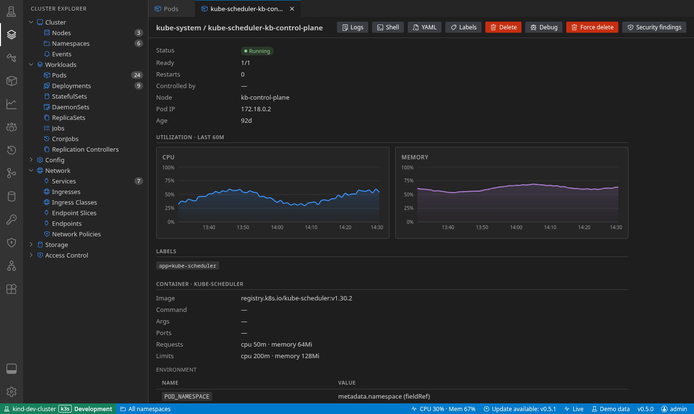
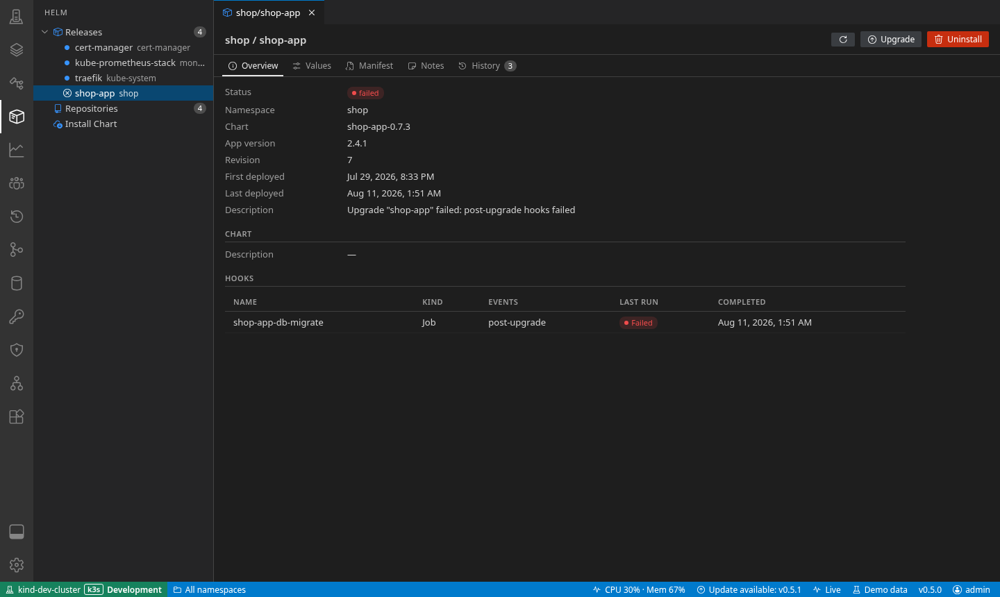
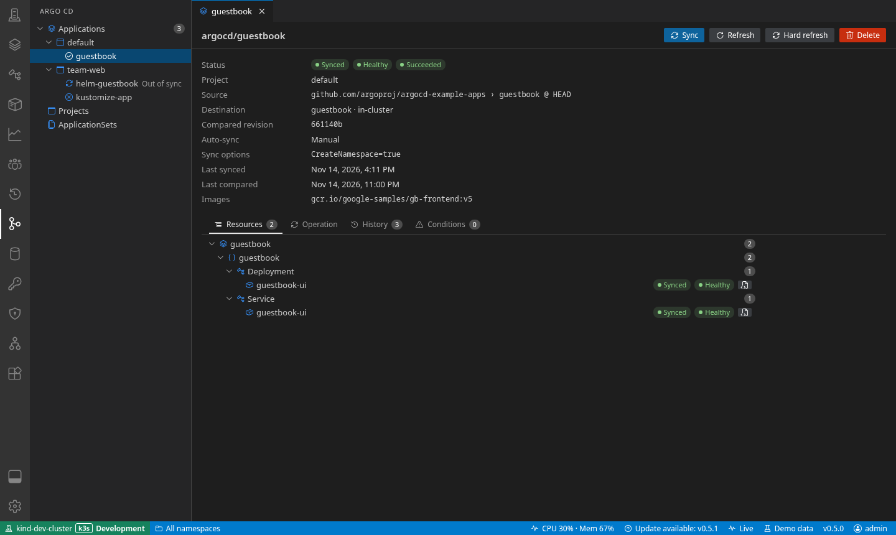
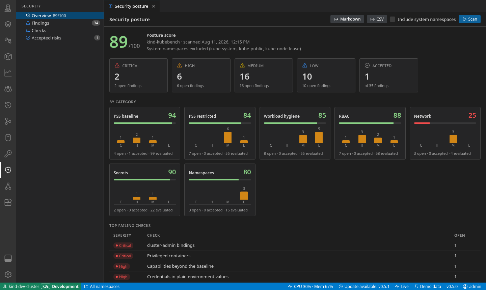
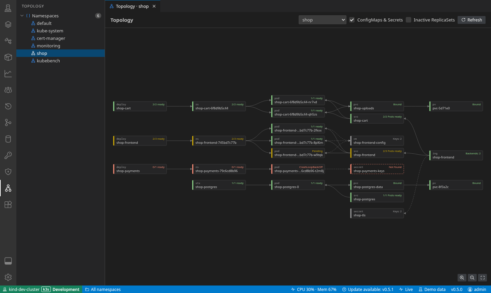
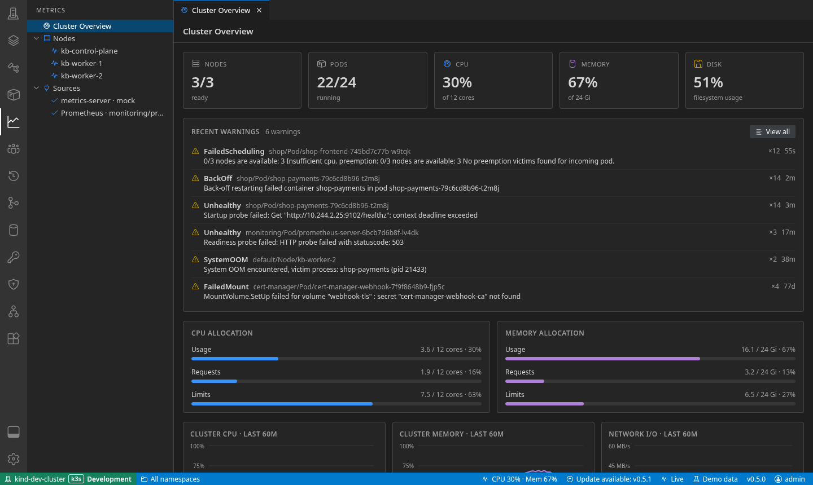
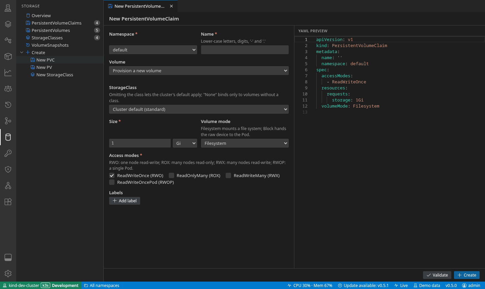
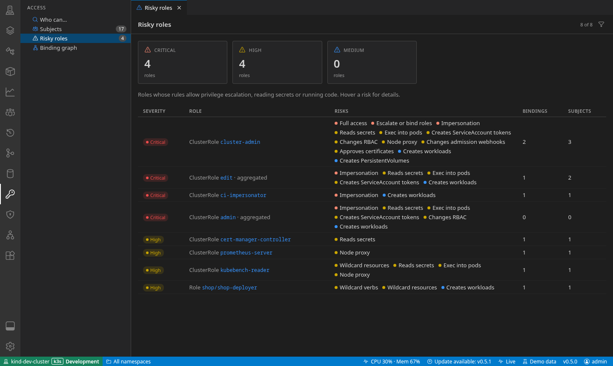
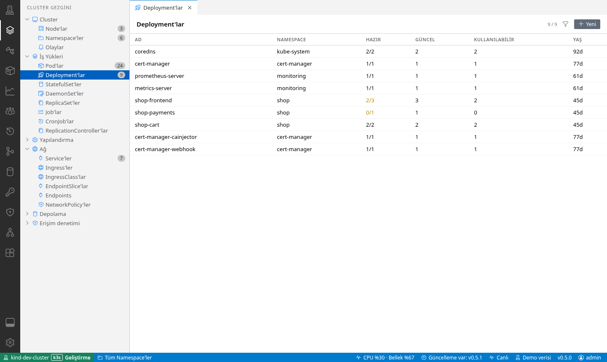

# KubeBench

KubeBench is a VS Code-style workbench for Kubernetes that runs in the
browser: an activity bar, a tabbed editor area, a bottom panel with
terminals and logs, a command palette and a status bar, with a module for
every part of daily cluster work. It is one Go binary with the UI embedded,
made for teams: it runs **inside the cluster it manages**, on a VM, in
Docker or on your laptop, keeps cluster credentials on the server and gives
every user a role per cluster.



## Highlights

- **Workloads** — every built-in resource type grouped by Cluster,
  Workloads, Config, Network, Storage and Access Control, with rich pages for
  Pods, Deployments and Nodes (utilization charts, containers, events,
  logs), events filters and recent warnings, namespace favourites, and
  windowed tables for large lists.
- **Editor** — YAML view (full or "neat"), edit with a diff review,
  server-side dry run and apply; create resources from templates or
  imported files; labels and annotations editor; delete with a propagation
  choice; Secret values revealed on demand.
- **Operations** — scale and restart Deployments, StatefulSets, DaemonSets
  and ReplicaSets; rollout history, rollback and pause; Node cordon, drain
  and taints; force and bulk Pod delete; debug containers; CronJob trigger
  and suspend; namespace create and delete.
- **Terminal and logs** — real shells over WebSocket (xterm.js, several
  sessions, resize) and streaming logs with follow, previous container,
  timestamps, filtering, download and multi-Pod selection by label.
- **Helm** — releases, history, values per revision with diffs, rollback,
  uninstall, install and upgrade with dry-run diffs, chart repositories,
  search, and chart upload for offline clusters.
- **Argo CD** — applications by project with sync and health, resource
  tree, sync (prune, dry run, revision, selected resources), refresh,
  rollback, delete, projects and ApplicationSets; through the Argo CD CRDs,
  no API token.
- **Storage** — overview of classes and capacity; PVC, PV and StorageClass
  wizards with validation, YAML preview and dry run; PVC clone, restore from
  snapshot and expansion.
- **Security** — posture scan of about 25 checks (Pod Security Standards,
  workload hygiene, RBAC, network policies, secrets in env vars, namespaces)
  with a score, accepted risks shared by the team, and Markdown/CSV export.
- **Access** — RBAC explorer: "who can …", effective permissions of a
  subject with the binding path, risky roles, binding graph and
  SubjectAccessReview checks.
- **Topology** — namespace graph Ingress → Service → Pod ← ReplicaSet ←
  Deployment, PVC → PV and ConfigMap/Secret references, with focus on one
  object.
- **Notes** — personal and shared Markdown notes on the cluster and its
  objects, with tags, search and pins; shared notes are visible to every
  user of the cluster.
- **Metrics** — cluster overview, allocation (requests and limits against
  allocatable) and per-node pages from metrics-server or an auto-discovered
  Prometheus.
- **CRDs** — custom resources grouped by API group, with CRD-specific
  columns.
- **Extensions** — admins enable and disable plugins; external UI plugins
  load at runtime through the `window.KubeBench` SDK.
- **Users and Audit** (admins) — users, per-cluster roles, and an audit log
  of every change, shell and admin action.
- **Live updates** — views refresh when the cluster changes (shared
  informers, Server-Sent Events), with a Live / Polling indicator.
- **Command palette** — kubectl-style commands (`get pods -n shop`,
  `describe deploy/web`, `logs`, `exec`, `ns`, `ctx`) with aliases, and
  keyboard shortcuts (`?` lists them).
- **Update check and What's new** — admins see new GitHub releases with
  their notes and upgrade steps; every user sees what changed after an
  upgrade. Turn it off for air-gapped installs.
- **EKS, AKS and GKE** — provider and version support detection with an
  end-of-life notice, and in-process sign-in for the clouds' kubeconfigs
  (per-cluster credentials or the server's cloud identity).
- **English, Turkish and German** UI, light, dark and system themes.

| | |
|---|---|
|  |  |
| Helm release with hooks, values, manifest and history | Argo CD application with its resource tree |
|  |  |
| Security posture score by category | Namespace topology |
|  |  |
| Cluster overview with recent warnings and allocation | PersistentVolumeClaim wizard with live YAML preview |
|  |  |
| Risky roles in the Access plugin | Light theme, Turkish UI |

The screenshots show the built-in demo data (`?demo`).

## Trust by design

- **Credentials stay on the server.** The browser talks only to KubeBench;
  KubeBench talks to the clusters.
- **Roles per cluster.** Global `admin` or `user`; on each assigned cluster
  `viewer` (read) or `operator` (read, change, shell). Clusters can be
  flagged **read-only** for everyone and tagged as development, staging or
  production; production asks you to type the name before destructive
  actions.
- **Audit log** of every change, shell and admin action, refused attempts
  included.
- **Secret values are redacted** everywhere unless someone with shell
  permission reveals them, which is audited.
- **Honest data.** Live mode never shows sample data: a missing capability
  (no Prometheus, no Argo CD, no RBAC access) is shown as unavailable with
  the reason.

Details: [SECURITY.md](SECURITY.md) and [docs/security.md](docs/security.md).

## Quick start

Every release on [GitHub](https://github.com/Shavell/kube-bench/releases)
ships the container image, the Helm chart, plain manifests, `.deb`/`.rpm`
packages, archives for Linux, macOS and Windows, the installer and an
offline bundle. The full guide, including TLS, reverse proxies, upgrades,
backups and air-gapped installs, is [docs/deployment.md](docs/deployment.md).

### Kubernetes

```bash
# Helm (OCI)
helm install kubebench oci://ghcr.io/shavell/charts/kubebench --version 0.5.0 \
  --namespace kubebench --create-namespace
kubectl -n kubebench get secret kubebench-auth -o jsonpath='{.data.admin-password}' | base64 -d; echo
kubectl -n kubebench port-forward svc/kubebench 8080:80      # http://localhost:8080, user admin

# or plain manifests (password admin, changed at the first sign-in)
kubectl apply -f https://github.com/Shavell/kube-bench/releases/download/v0.5.0/kubebench.yaml
```

KubeBench registers the cluster it runs in as `in-cluster` through its
ServiceAccount; the chart's `rbac.preset` (`cluster-admin`, `read-only`,
`custom`) decides what it may do there. Add more clusters in the Clusters
view. Chart values: [charts/kubebench/README.md](charts/kubebench/README.md).

### Virtual machine

```bash
# installer: picks .deb, .rpm or the tarball, verifies checksums, starts the service
curl -fsSL https://raw.githubusercontent.com/Shavell/kube-bench/main/install.sh | sudo bash

# or the packages
sudo apt install ./kubebench_0.5.0_amd64.deb
sudo dnf install ./kubebench-0.5.0-1.x86_64.rpm
```

The installer prints a generated admin password; the packages start with
`admin`/`admin`. Configuration lives in `/etc/kubebench/kubebench.env`, data
in `/var/lib/kubebench`. Without internet access:
`sudo bash install.sh --offline kubebench-offline-0.5.0.tar.gz`.

### Docker

```bash
docker run -d --name kubebench -p 9876:9876 -v kubebench-data:/data \
  -e KUBEBENCH_ADMIN_PASSWORD='choose-a-password' ghcr.io/shavell/kube-bench:0.5.0
```

Open http://localhost:9876 and sign in as `admin`. KubeBench asks for a new
password at the first sign-in, whatever the install method.

### On your machine

```bash
KUBEBENCH_LISTEN_ADDR=127.0.0.1:9876 KUBECONFIG=~/.kube/config ./kubebench
```

## Development

Requirements: Node.js 24 and npm, Go (the version in `backend/go.mod`),
make. Optional: Docker, Helm, kubectl and a local cluster (k3d or kind).

```bash
npm ci

# UI only, on deterministic demo data (no backend needed)
npm run dev                                         # http://localhost:5173

# UI + backend against a cluster
KUBECONFIG=/path/to/kubeconfig npm run server:go    # http://localhost:9876
npm run dev                                          # proxies /api to :9876

# the embedded production build
make build && ./bin/kubebench
```

Checks before a pull request:

```bash
npx tsc -b && npm run build && npm run lint && npm run i18n:check && npm test
cd backend && go vet ./... && go test ./... && go build ./...
```

`make help` lists every target (tests, lint, chart lint, manifests, image,
packages, snapshot release). Contribution rules: [CONTRIBUTING.md](CONTRIBUTING.md).

## Documentation

| Document | Contents |
|---|---|
| [docs/deployment.md](docs/deployment.md) | Installing, TLS, upgrades, backups, cloud clusters |
| [docs/configuration.md](docs/configuration.md) | Every environment variable and chart value |
| [docs/security.md](docs/security.md) | Security model, threat model, hardening checklist |
| [docs/architecture.md](docs/architecture.md) | Backend packages, router, plugin platform, frontend layers |
| [docs/plugins.md](docs/plugins.md) | Writing core, backend and external plugins; the SDK |
| [docs/api.md](docs/api.md) | HTTP API reference |
| [docs/i18n.md](docs/i18n.md) | Translations and adding a language |
| [docs/releasing.md](docs/releasing.md) | Versioning and cutting a release |
| [docs/design-v0.5.md](docs/design-v0.5.md) | The v0.5 implementation contract |
| [docs/notes/kubelizeme-comparison.md](docs/notes/kubelizeme-comparison.md) | How KubeBench compares with KubelizeMe |
| [CHANGELOG.md](CHANGELOG.md) | Release history |

## License

KubeBench is free software, licensed under the [GNU General Public License v3.0](LICENSE) (`GPL-3.0-only`). Contributions are accepted under the same license with a [Developer Certificate of Origin](CONTRIBUTING.md#developer-certificate-of-origin) sign-off.
