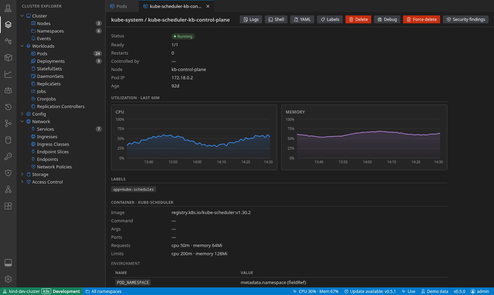
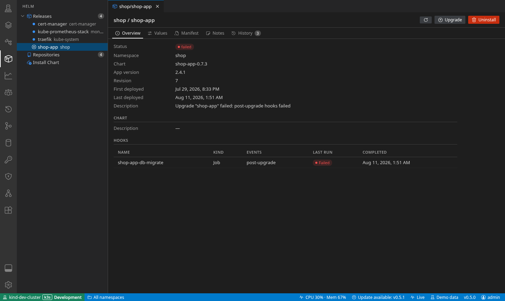
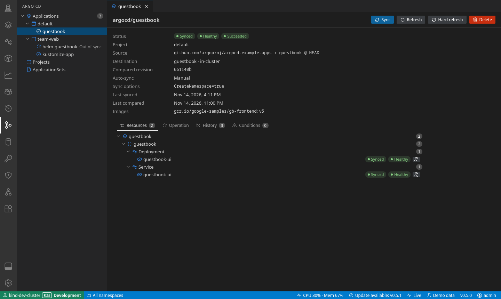
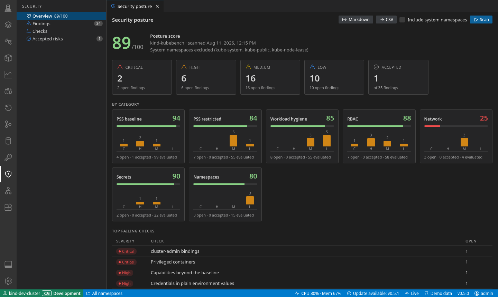
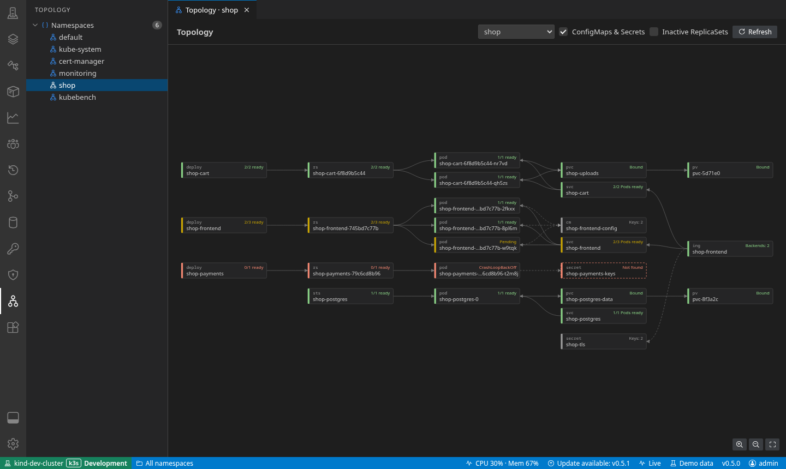
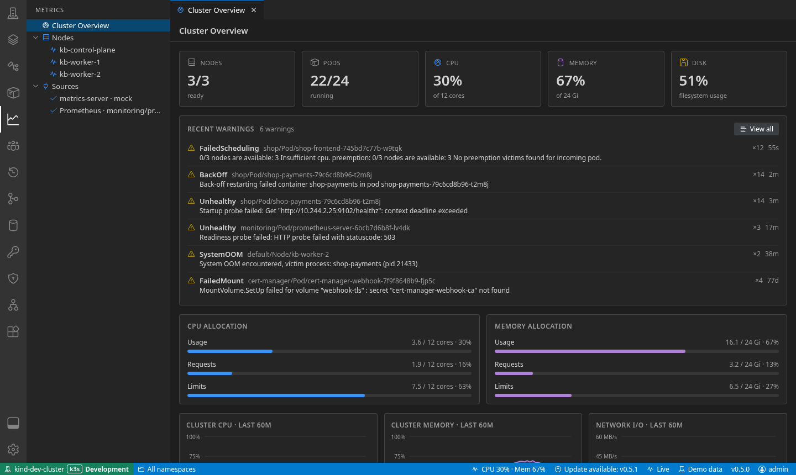
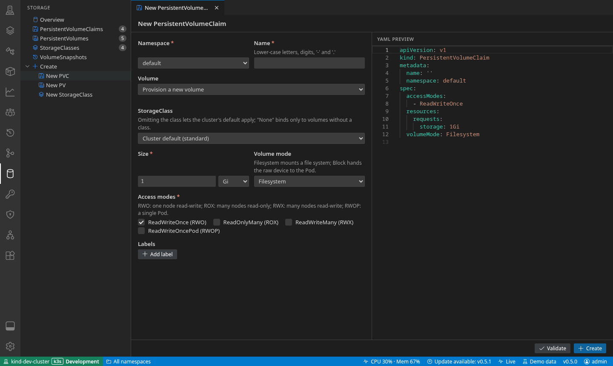
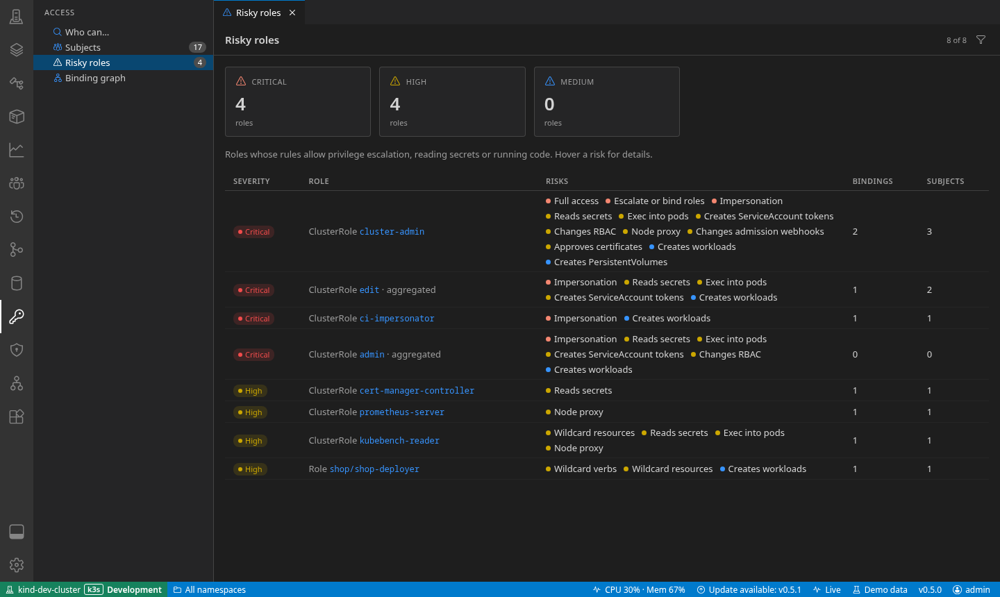
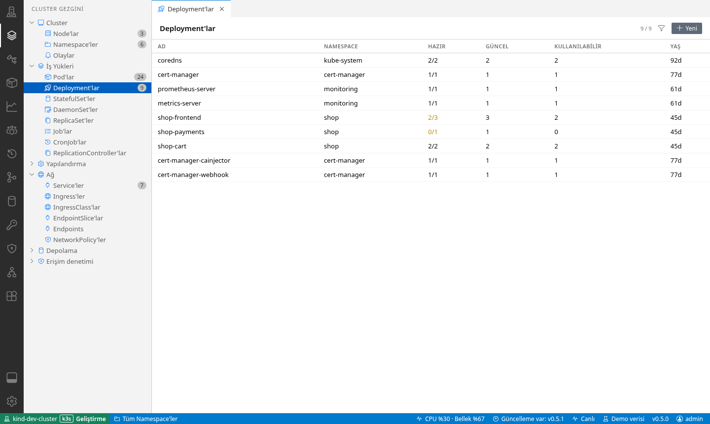

# KubeBench

*English: [README.md](README.md)*

KubeBench, tarayıcıda çalışan VS Code tarzı bir Kubernetes çalışma
tezgâhıdır: etkinlik çubuğu, sekmeli düzenleyici alanı, terminallerin ve
log'ların bulunduğu alt panel, komut paleti ve durum çubuğu; günlük cluster
işlerinin her biri için bir modül. Arayüzü içine gömülü tek bir Go
programıdır ve ekipler için tasarlanmıştır: **yönettiği cluster'ın içinde**,
bir sanal makinede, Docker'da ya da kendi bilgisayarınızda çalışır, cluster
kimlik bilgilerini sunucuda tutar ve her kullanıcıya cluster başına bir rol
verir.



## Öne çıkanlar

- **İş Yükleri** — tüm yerleşik kaynak türleri Cluster, İş Yükleri,
  Yapılandırma, Ağ, Depolama ve Erişim denetimi başlıkları altında; Pod,
  Deployment ve Node'lar için zengin sayfalar (kullanım grafikleri,
  container'lar, olaylar, log'lar), olay filtreleri ve son uyarılar,
  favori namespace'ler ve büyük listeler için pencereli tablolar.
- **Düzenleyici** — YAML görünümü (tam ya da "sade"), fark incelemesiyle
  düzenleme, sunucu tarafı deneme çalıştırması (dry run) ve uygulama;
  şablonlardan ya da içe aktarılan dosyalardan kaynak oluşturma; etiket ve
  açıklama (annotation) düzenleyici; yayılma (propagation) seçimiyle silme;
  isteğe bağlı olarak gösterilen Secret değerleri.
- **İşlemler** — Deployment, StatefulSet, DaemonSet ve ReplicaSet'leri
  ölçekleme ve yeniden başlatma; rollout geçmişi, geri alma ve duraklatma;
  Node cordon, drain ve taint'ler; Pod'ları zorla ve toplu silme; debug
  container'ları; CronJob tetikleme ve askıya alma; namespace oluşturma ve
  silme.
- **Terminal ve log'lar** — WebSocket üzerinden gerçek kabuklar (xterm.js,
  birden çok oturum, yeniden boyutlandırma) ve izleme, önceki container,
  zaman damgaları, filtreleme, indirme ve etikete göre birden çok Pod seçimi
  sunan canlı log'lar.
- **Helm** — release'ler, geçmiş, revizyon başına değerler ve farkları,
  geri alma, kaldırma, deneme farklarıyla kurulum ve yükseltme, chart
  depoları, arama ve çevrimdışı cluster'lar için chart yükleme.
- **Argo CD** — projelere göre uygulamalar ve sync/sağlık durumları, kaynak
  ağacı, sync (prune, deneme, revizyon, seçili kaynaklar), yenileme, geri
  alma, silme, projeler ve ApplicationSet'ler; Argo CD CRD'leri üzerinden,
  API token'ı gerekmeden.
- **Depolama** — sınıfların ve kapasitenin özeti; doğrulama, YAML önizlemesi
  ve deneme çalıştırmasıyla PVC, PV ve StorageClass sihirbazları; PVC
  klonlama, snapshot'tan geri yükleme ve genişletme.
- **Güvenlik** — yaklaşık 25 denetimden oluşan güvenlik duruşu taraması
  (Pod Security Standards, iş yükü hijyeni, RBAC, NetworkPolicy'ler, ortam
  değişkenlerindeki gizli bilgiler, namespace'ler); puan, ekipçe paylaşılan
  kabul edilmiş riskler ve Markdown/CSV dışa aktarma.
- **Erişim** — RBAC gezgini: "kim … yapabilir", bir öznenin binding yoluyla
  birlikte etkin izinleri, riskli roller, binding grafiği ve
  SubjectAccessReview denetimleri.
- **Topoloji** — namespace grafiği: Ingress → Service → Pod ← ReplicaSet ←
  Deployment, PVC → PV ve ConfigMap/Secret başvuruları; tek bir nesneye
  odaklanma.
- **Metrikler** — metrics-server'dan ya da otomatik bulunan bir
  Prometheus'tan cluster özeti, ayırma (allocatable'a karşı request ve
  limit'ler) ve Node başına sayfalar.
- **Özel kaynaklar** — API grubuna göre gruplanmış özel kaynaklar ve CRD'ye
  özgü sütunlar.
- **Eklentiler** — yöneticiler eklentileri etkinleştirir ve devre dışı
  bırakır; harici arayüz eklentileri çalışma anında `window.KubeBench` SDK'sı
  ile yüklenir.
- **Kullanıcılar ve Denetim kaydı** (yöneticiler) — kullanıcılar, cluster
  başına roller ve her değişikliğin, kabuğun ve yönetici işleminin kaydı.
- **Canlı güncellemeler** — görünümler cluster değiştiğinde yenilenir
  (paylaşılan informer'lar, Server-Sent Events); Canlı / Yoklanıyor göstergesi.
- **Komut paleti** — kubectl tarzı komutlar (`get pods -n shop`,
  `describe deploy/web`, `logs`, `exec`, `ns`, `ctx`), takma adlar ve klavye
  kısayolları (`?` hepsini listeler).
- **Güncelleme denetimi ve Yenilikler** — yöneticiler GitHub'daki yeni
  sürümleri notları ve yükseltme adımlarıyla görür; her kullanıcı bir
  yükseltmeden sonra nelerin değiştiğini görür. İnternetsiz kurulumlarda
  kapatılabilir.
- **EKS, AKS ve GKE** — sağlayıcı ve sürüm desteği tespiti, destek sonu
  uyarısı ve bulutların kubeconfig'leri için süreç içinde oturum açma
  (cluster başına kimlik bilgileri ya da sunucunun bulut kimliği).
- **İngilizce, Türkçe ve Almanca** arayüz; açık, koyu ve sistem temaları.

| | |
|---|---|
|  |  |
| Hook'ları, değerleri, manifest'i ve geçmişiyle bir Helm release'i | Kaynak ağacıyla bir Argo CD uygulaması |
|  |  |
| Kategorilere göre güvenlik duruşu puanı | Namespace topolojisi |
|  |  |
| Son uyarılar ve ayırmayla cluster özeti | Canlı YAML önizlemeli PersistentVolumeClaim sihirbazı |
|  |  |
| Erişim eklentisinde riskli roller | Açık tema, Türkçe arayüz |

Ekran görüntüleri yerleşik demo verilerini (`?demo`) gösterir.

## Tasarımdan gelen güven

- **Kimlik bilgileri sunucuda kalır.** Tarayıcı yalnızca KubeBench ile,
  KubeBench de cluster'larla konuşur.
- **Cluster başına roller.** Genel rol `admin` ya da `user`; atanan her
  cluster'da `viewer` (izleyici: okuma) ya da `operator` (operatör: okuma,
  değiştirme, kabuk). Cluster'lar herkes için **salt okunur** işaretlenebilir
  ve geliştirme, hazırlık ya da üretim olarak etiketlenebilir; üretimde yıkıcı
  işlemlerden önce adı yazmanız istenir.
- **Denetim kaydı:** her değişiklik, kabuk ve yönetici işlemi, reddedilen
  denemeler dahil kaydedilir.
- **Secret değerleri** kabuk izni olan biri göstermedikçe her yerde
  gizlenir; gösterme işlemi de kaydedilir.
- **Dürüst veri.** Canlı modda hiçbir zaman örnek veri gösterilmez: eksik
  bir yetenek (Prometheus, Argo CD ya da RBAC erişimi yoksa) nedeniyle
  birlikte kullanılamıyor olarak gösterilir.

Ayrıntılar: [SECURITY.md](SECURITY.md) ve [docs/security.md](docs/security.md).

## Hızlı başlangıç

[GitHub](https://github.com/Shavell/kube-bench/releases)'daki her sürüm
container imajını, Helm chart'ını, düz manifest'leri, `.deb`/`.rpm`
paketlerini, Linux, macOS ve Windows arşivlerini, kurulum betiğini ve
çevrimdışı paketi içerir. TLS, ters vekil sunucular, yükseltmeler,
yedekler ve internetsiz kurulumlar dahil tam kılavuz:
[docs/deployment.md](docs/deployment.md) (İngilizce).

### Kubernetes

```bash
# Helm (OCI)
helm install kubebench oci://ghcr.io/shavell/charts/kubebench --version 0.5.0 \
  --namespace kubebench --create-namespace
kubectl -n kubebench get secret kubebench-auth -o jsonpath='{.data.admin-password}' | base64 -d; echo
kubectl -n kubebench port-forward svc/kubebench 8080:80      # http://localhost:8080, kullanıcı admin

# ya da düz manifest'ler (parola admin, ilk girişte değiştirilir)
kubectl apply -f https://github.com/Shavell/kube-bench/releases/download/v0.5.0/kubebench.yaml
```

KubeBench çalıştığı cluster'ı ServiceAccount'u üzerinden `in-cluster` adıyla
kaydeder; orada neler yapabileceğini chart'ın `rbac.preset` değeri
(`cluster-admin`, `read-only`, `custom`) belirler. Başka cluster'ları
Cluster'lar görünümünden ekleyin. Chart değerleri:
[charts/kubebench/README.md](charts/kubebench/README.md).

### Sanal makine

```bash
# kurulum betiği: .deb, .rpm ya da tarball'u seçer, sağlama toplamlarını doğrular, servisi başlatır
curl -fsSL https://raw.githubusercontent.com/Shavell/kube-bench/main/install.sh | sudo bash

# ya da paketler
sudo apt install ./kubebench_0.5.0_amd64.deb
sudo dnf install ./kubebench-0.5.0-1.x86_64.rpm
```

Kurulum betiği üretilen yönetici parolasını yazdırır; paketler
`admin`/`admin` ile başlar. Yapılandırma `/etc/kubebench/kubebench.env`
dosyasında, veriler `/var/lib/kubebench` dizinindedir. İnternet erişimi
olmadan: `sudo bash install.sh --offline kubebench-offline-0.5.0.tar.gz`.

### Docker

```bash
docker run -d --name kubebench -p 9876:9876 -v kubebench-data:/data \
  -e KUBEBENCH_ADMIN_PASSWORD='bir-parola-secin' ghcr.io/shavell/kube-bench:0.5.0
```

http://localhost:9876 adresini açın ve `admin` olarak giriş yapın.
Kurulum yöntemi ne olursa olsun KubeBench ilk girişte yeni bir parola ister.

### Kendi bilgisayarınızda

```bash
KUBEBENCH_LISTEN_ADDR=127.0.0.1:9876 KUBECONFIG=~/.kube/config ./kubebench
```

## Geliştirme

Gerekenler: Node.js 24 ve npm, Go (`backend/go.mod` dosyasındaki sürüm),
make. İsteğe bağlı: Docker, Helm, kubectl ve yerel bir cluster (k3d ya da
kind).

```bash
npm ci

# yalnızca arayüz, deterministik demo verileriyle (backend gerekmez)
npm run dev                                         # http://localhost:5173

# arayüz + bir cluster'a bağlı backend
KUBECONFIG=/kubeconfig/yolu npm run server:go       # http://localhost:9876
npm run dev                                          # /api isteklerini :9876'ya iletir

# gömülü üretim derlemesi
make build && ./bin/kubebench
```

Pull request'ten önce çalıştırılacak denetimler:

```bash
npx tsc -b && npm run build && npm run lint && npm run i18n:check && npm test
cd backend && go vet ./... && go test ./... && go build ./...
```

`make help` tüm hedefleri listeler (testler, lint, chart lint, manifest'ler,
imaj, paketler, snapshot sürüm). Katkı kuralları:
[CONTRIBUTING.md](CONTRIBUTING.md) (İngilizce).

## Belgeler

Belgeler İngilizcedir.

| Belge | İçerik |
|---|---|
| [docs/deployment.md](docs/deployment.md) | Kurulum, TLS, yükseltmeler, yedekler, bulut cluster'ları |
| [docs/configuration.md](docs/configuration.md) | Tüm ortam değişkenleri ve chart değerleri |
| [docs/security.md](docs/security.md) | Güvenlik modeli, tehdit modeli, sağlamlaştırma listesi |
| [docs/architecture.md](docs/architecture.md) | Backend paketleri, yönlendirici, eklenti platformu, arayüz katmanları |
| [docs/plugins.md](docs/plugins.md) | Çekirdek, backend ve harici eklenti yazma; SDK |
| [docs/api.md](docs/api.md) | HTTP API başvurusu |
| [docs/i18n.md](docs/i18n.md) | Çeviriler ve yeni dil ekleme |
| [docs/releasing.md](docs/releasing.md) | Sürümleme ve sürüm çıkarma |
| [docs/design-v0.5.md](docs/design-v0.5.md) | v0.5 uygulama sözleşmesi |
| [docs/notes/kubelizeme-comparison.tr.md](docs/notes/kubelizeme-comparison.tr.md) | KubeBench ile KubelizeMe karşılaştırması |
| [CHANGELOG.md](CHANGELOG.md) | Sürüm geçmişi |

## Lisans

KubeBench kaynağı erişilebilir (source-available) bir projedir. Lisans henüz
seçilmedi; lisans dosyası ilk herkese açık sürümden önce eklenecek. Katkılar
[Katkıda Bulunan Lisans Sözleşmesi](CONTRIBUTING.md#contributor-license-agreement)
(CLA) kapsamında kabul edilir.
